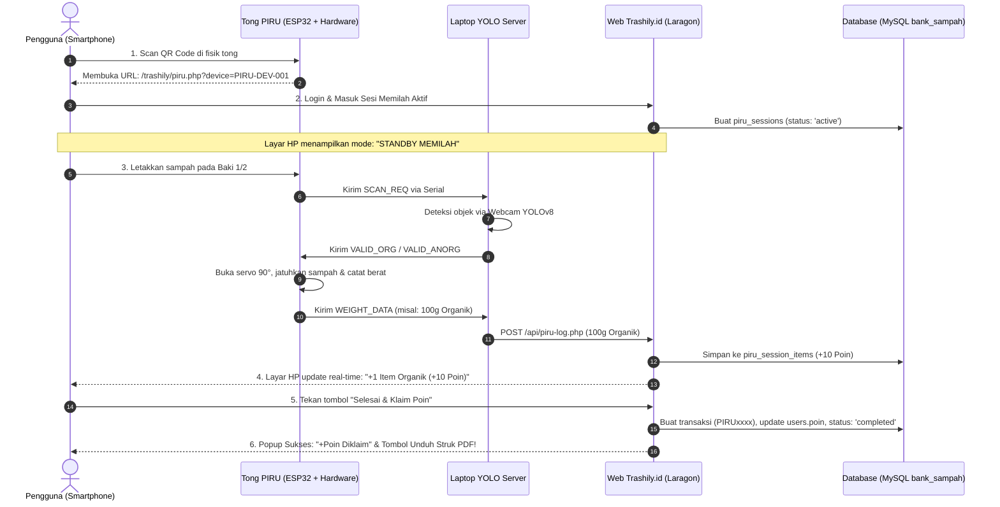

# PIRU (Pilah Runtah) - Smart IoT Waste Sorter System
### Terintegrasi Penuh dengan Ekosistem Web Trashily.id

**PIRU (Pilah Runtah)** adalah sistem tempat sampah pintar berbasis *Edge AI (Computer Vision YOLOv8)* & *Internet of Things (IoT)* yang memilah sampah secara otomatis ke dalam dua kompartemen: **ORGANIK** dan **ANORGANIK**.

Sistem ini terintegrasi penuh dengan platform web **Trashily.id** melalui alur **QR Code Session, Live Telemetry, Reward Points, dan Bukti Sesi PDF Resmi**. Pengguna cukup memindai QR Code pada fisik unit PIRU menggunakan smartphone, meletakkan sampah ke baki yang divalidasi oleh kamera **Ultralytics YOLOv8**, dan menekan tombol **"Selesai & Klaim Poin"** di HP untuk langsung menerima poin reward serta mengunduh tanda terima PDF resmi.

---

## 📱 Alur Kerja Sistem Terintegrasi (End-to-End Workflow)



---

## 📐 Arsitektur Perangkat Keras & AI

```mermaid
flowchart TD
    subgraph HARDWARE_ESP32["ESP32 DOIT DevKit V1 (PIRU Bin)"]
        IR1["Sensor IR Baki 1 (Organik)<br/>GPIO 27"]
        IR2["Sensor IR Baki 2 (Anorganik)<br/>GPIO 23"]
        US1["Ultrasonik Organik (JSN-SR04T)<br/>TRIG: 25, ECHO: 26"]
        US2["Ultrasonik Anorganik (JSN-SR04T)<br/>TRIG: 32, ECHO: 33"]
        LCD["LCD 16x2 I2C (0x27)<br/>SDA: 21, SCL: 22"]
        BUZZ["Active Buzzer 5V<br/>GPIO 12"]
        SRV1["Servo 1 MG996R (Baki Org)<br/>GPIO 13"]
        SRV2["Servo 2 MG996R (Baki Anorg)<br/>GPIO 14"]
        LC1["Load Cell 1 (HX711 Org)<br/>DOUT: 4, SCK: 5"]
        LC2["Load Cell 2 (HX711 Anorg)<br/>DOUT: 18, SCK: 19"]
    end

    subgraph SERVER_YOLO["Laptop / Server Edge AI"]
        CAM["Webcam / Kamera Laptop"]
        YOLO_AI["Ultralytics YOLOv8 Inference Engine"]
        HUD["OpenCV Real-time HUD Window"]
        BRIDGE["PySerial Duplex Worker"]
        TTS["Text-to-Speech Engine (SAPI Voice)"]
    end

    subgraph WEB_TRASHILY["Web Backend Trashily.id (C:\\laragon\\www\\trashily)"]
        QR_GATEWAY["/piru.php (QR Landing & Simulator)"]
        USER_SESSION["/customer/piru.php (Live Screen)"]
        USER_PDF["/customer/export-session-pdf.php (Struk Sesi PDF)"]
        ADMIN_MONITOR["/admin/monitoring-piru.php (Monitoring IoT)"]
        ADMIN_PDF["/admin/export-piru-pdf.php (Laporan Resmi PDF A4)"]
        ADMIN_EXCEL["/admin/export-piru-excel.php (Export Rekap Excel)"]
        LOG_API["/api/piru-log.php (Weight Webhook)"]
        SES_API["/api/piru-session.php (Points Claim)"]
        DB_MYSQL[("MySQL: bank_sampah")]
    end

    IR1 -->|Objek Terdeteksi| HARDWARE_ESP32
    IR2 -->|Objek Terdeteksi| HARDWARE_ESP32
    HARDWARE_ESP32 -->|SCAN_REQ via Serial| BRIDGE
    CAM --> YOLO_AI
    YOLO_AI --> HUD
    YOLO_AI --> TTS
    BRIDGE -->|VALID_ORG / VALID_ANORG / INVALID| HARDWARE_ESP32
    HARDWARE_ESP32 -->|Buka Servo & Timbang Berat| SRV1
    HARDWARE_ESP32 -->|Buka Servo & Timbang Berat| SRV2
    HARDWARE_ESP32 -->|WEIGHT_DATA JSON| BRIDGE
    BRIDGE -->|HTTP POST| LOG_API
    LOG_API --> DB_MYSQL
    USER_SESSION <-->|Polling Live Status & Claim Poin| SES_API
    SES_API --> DB_MYSQL
    USER_SESSION --> USER_PDF
    ADMIN_MONITOR --> ADMIN_PDF
    ADMIN_MONITOR --> ADMIN_EXCEL
```



---

## 🔌 Pemetaan Pin GPIO ESP32 (DOIT DevKit V1 - 30 Pin)

| Modul / Komponen | Pin Modul | GPIO ESP32 | Mode Pin / Keterangan |
| :--- | :--- | :--- | :--- |
| **LCD 16x2 I2C** | SDA | **GPIO 21** | I2C Data Line |
| | SCL | **GPIO 22** | I2C Clock Line |
| | VCC / GND | 5V / GND | Alamat default I2C `0x27` (atau `0x3F`) |
| **Sensor IR Baki 1 (Organik)** | OUT | **GPIO 27** | `INPUT_PULLUP` (E18-D80NK Active LOW) |
| **Sensor IR Baki 2 (Anorganik)** | OUT | **GPIO 23** | `INPUT_PULLUP` (E18-D80NK Active LOW) |
| **Motor Servo 1 (Organik)** | Signal (Orange) | **GPIO 13** | PWM Servo Control (`ESP32Servo`) |
| **Motor Servo 2 (Anorganik)** | Signal (Orange) | **GPIO 14** | PWM Servo Control (`ESP32Servo`) |
| **Load Cell 1 (Organik)** | DOUT / DT | **GPIO 4** | Data HX711 |
| | SCK / CLK | **GPIO 5** | Clock HX711 |
| **Load Cell 2 (Anorganik)** | DOUT / DT | **GPIO 18** | Data HX711 |
| | SCK / CLK | **GPIO 19** | Clock HX711 |
| **Ultrasonik 1 (Organik)** | TRIG | **GPIO 25** | Trigger JSN-SR04T |
| | ECHO | **GPIO 26** | Echo JSN-SR04T |
| **Ultrasonik 2 (Anorganik)** | TRIG | **GPIO 32** | Trigger JSN-SR04T |
| | ECHO | **GPIO 33** | Echo JSN-SR04T |
| **Active Buzzer 5V** | Positif (+) | **GPIO 12** | `OUTPUT` (Strapping Pin; di-drive LOW saat boot) |

---

## 🗂️ Endpoint & Komponen Web Trashily yang Terhubung

Semua komponen web backend dan UI telah disesuaikan dan siap beroperasi:

1. **`piru.php` (Landing Page & QR Gateway):**
   - Halaman publik saat QR code di-scan.
   - Jika sudah login, otomatis dialihkan langsung ke layar kontrol sesi (`customer/piru.php`).
   - Dilengkapi **Simulator Interaktif YOLO** di browser, spesifikasi hardware, dan display status unit live.
2. **`customer/piru.php` (Layar Interaktif Sesi Memilah & Live IoT):**
   - Menampilkan status *"STANDBY MEMILAH"* dengan animasi HUD radar scanner, visualizer gelombang suara, dan status koneksi live hardware (`Live IoT Online`).
   - Dilengkapi **Dual Compartment Capacity Gauges**: Memantau ketinggian isi tong sampah secara real-time via sensor ultrasonik JSN-SR04T (Organik & Anorganik).
   - Menampilkan nama spesifik objek yang dideteksi oleh AI YOLO (cth: `🍎 Sisa Buah Apel (apple)`, `🍾 Botol Plastik (bottle)`, `📦 Kardus Karton (cardboard)`).
   - Dilengkapi **Panel Uji Cepat Sensor Baki IoT**: Memungkinkan pengetesan pemicuan sensor baki langsung dari web untuk verifikasi integrasi.
   - Mengambil pembaruan secara live (setiap 1.5 detik) saat sampah masuk ke tong.
   - Skor item & poin terdistribusi:
     - **Sampah Organik:** +10 Poin per item
     - **Sampah Anorganik:** +15 Poin per item
   - Tombol **"Selesai & Klaim Poin"** (Modal selebrasi konfeti + Tombol unduh Struk Bukti Sesi PDF).
3. **`customer/export-session-pdf.php` (Struk / Bukti Sesi PDF):**
   - Dokumen digital cetak resmi untuk customer dengan rincian nama item terdeteksi AI, bobot per gram, poin, dampak reduksi karbon $CO_2e$, dan verifikasi QR Code.
4. **`admin/monitoring-piru.php` (Dashboard Monitoring IoT):**
   - Memantau kapasitas wadah fisik kompartemen (JSN-SR04T), ping status online/offline, log telemetri suara, dan riwayat sesi pengguna dengan rincian nama sampah AI di modal rincian.
   - Dilengkapi tombol **"Export PDF Laporan"** dan **"Export Excel (.xls)"**.
5. **`admin/export-piru-pdf.php` (Laporan Resmi A4 PDF):**
   - Laporan resmi monitoring PIRU siap cetak / simpan ke PDF dengan Kop Surat, Executive KPI Cards, tabel data sesi, dan lembar tanda tangan pengesahan.
6. **`api/piru-log.php` (Webhook Sinkronisasi YOLO & Telemetri):**
   - Menerima POST JSON dari `piru_yolo_server.py`.
   - Mengaitkan item sampah (`category` + `item_name`) ke sesi aktif customer, mencatat ke `piru_session_items`, mengupdate kapasitas kompartemen di `trashsmart_devices`, dan memperbarui log telemetri `trashsmart_logs`.
   - Mendukung heartbeat telemetri `{"action": "ping", "device_id": "PIRU-DEV-001"}` agar status IoT di web selalu aktif (*online*).
7. **`api/piru-session.php` (Session & Point Claim Manager):**
   - `action=start`: Memulai sesi pemilahan baru.
   - `action=status`: Mengembalikan daftar item yang berhasil dipilah dalam sesi aktif beserta telemetri real-time hardware (`is_online`, `kapasitas_organik`, `kapasitas_anorganik`).
   - `action=simulate`: Memicu simulasi pemindaian item baki langsung dari UI web untuk verifikasi koneksi.
   - `action=complete`: Menerbitkan transaksi resmi, mengkredit poin ke akun customer, dan menyelesaikan sesi.

---

## 🚀 Panduan Menjalankan Sistem

### 1. Flash Firmware ESP32
1. Buka folder `PIRU IOT/firmware/esp32_piru/esp32_piru.ino` di Arduino IDE.
2. Pastikan library terpasang: `LiquidCrystal_I2C`, `ESP32Servo`, `HX711`.
3. Upload ke ESP32 DOIT DevKit V1 (Baudrate: `115200`).

### 2. Jalankan Python YOLO Server (Laptop)
```powershell
cd "c:\laragon\www\trashily\PIRU IOT"
pip install -r requirements.txt
python piru_yolo_server.py
```
*Script otomatis mendeteksi COM Port ESP32 dan webcam laptop, lalu menghubungkan data ke `https://trashily.id/api/piru-log.php`.*

### 3. Cetak / Tampilkan QR Code untuk Tong Sampah
Jalankan script pembuat QR code:
```powershell
# Menghasilkan QR Code untuk domain produksi trashily.id
python generate_piru_qr.py

# Atau deteksi IP Wi-Fi lokal otomatis agar dapat dipindai oleh HP di jaringan yang sama:
python generate_piru_qr.py --auto-ip
```
File siap cetak tersedia di:
- **PNG QR Code:** `qr_PIRU-DEV-001.png`
- **Template Standee / Stiker:** `standee_PIRU-DEV-001.html` (Buka dan cetak via browser).

### 4. Fitur Suara Vokal (Text-to-Speech - TTS)
Script `piru_yolo_server.py` dilengkapi engine suara vokal berbahasa Indonesia otomatis:
- Saat terdeteksi **Organik**: Laptop bersuara *"Organik"*.
- Saat terdeteksi **Anorganik**: Laptop bersuara *"Anorganik"*.
- Saat salah baki: Laptop bersuara *"Salah baki"*.
*(Berjalan secara native offline menggunakan Windows SAPI.SpVoice tanpa perlu koneksi internet atau dependensi library eksternal).*

---

## ⚖️ Penyesuaian Sensor Berat (Load Cell)
Karena sensor berat fisik (Load Cell 50kg + HX711) **belum terpasang**, sistem telah diatur ke mode simulasi aman:
- Pada `firmware/esp32_piru/config.h`:
  ```cpp
  #define USE_LOADCELL false
  #define DUMMY_WEIGHT_GRAM 100.0f
  ```
- ESP32 tidak memblokir/menunggu bacaan modul HX711, melainkan langsung membuka/menutup servo serta mengirimkan data transaksi nominal (100 gram) agar pengguna tetap mendapatkan poin di Trashily.id.
- **Cara Mengaktifkan Kembali saat Sensor Fisik Sudah Ada:**
  Cukup ubah `#define USE_LOADCELL false` menjadi `true` di `config.h`, lalu upload ulang firmware.
